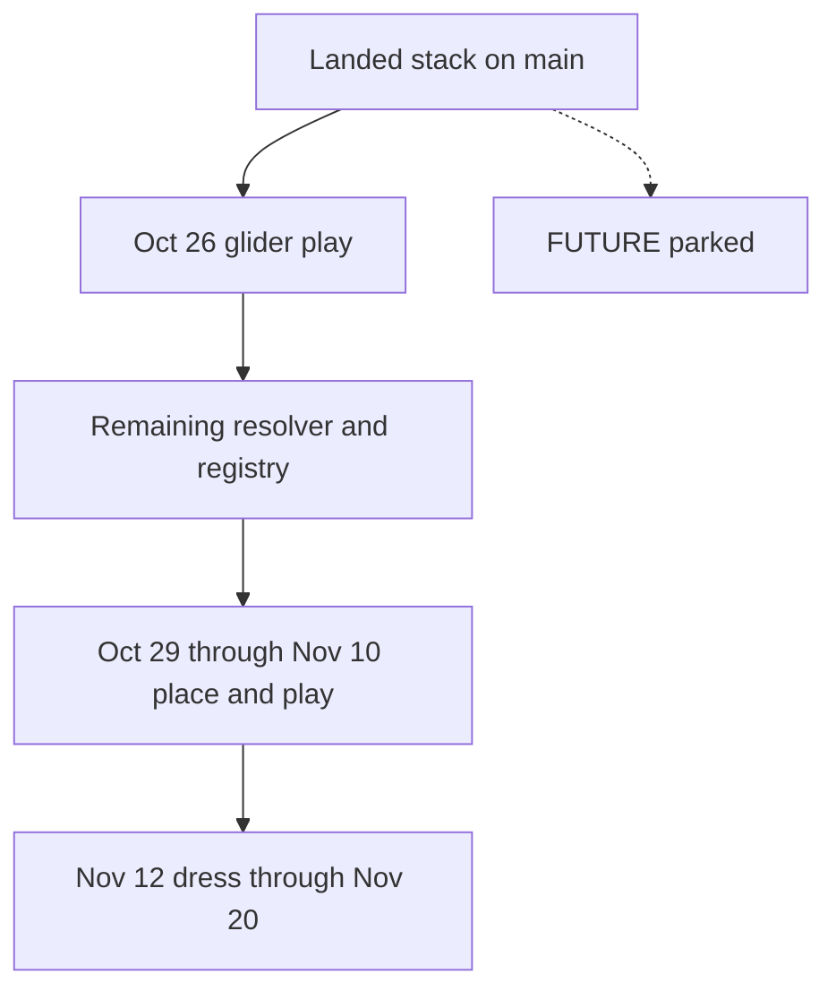

# 46 — NOV20 upgrade plan

**Status:** Filed 2026-10-22. Updated 2026-10-23 on `fix/fromtext-exact`. Questions 1, 2, 3, 5, 6, and 7 are unpicked. Question 4 is not edited on this branch.
**Owner:** This file. The review it sorts is `Docs/handoffs/research/EXIT_VISION_MARKET_TECH_V1.md`.
**Queue:** `Docs/qa/TUTORIAL_PLAYTEST_QUEUE.md`. A dated row there wins over a sentence here.
**This session:** These two files only. Source, Content, the research README, and the canon map were not edited. Nothing was committed.

The played pass for every NOV20 item is `/Game/HomeWorld/Maps/SizeTest/L_SizeTest`. A green host run does not fill a queue table.

2026-10-23: the beat table is in `HomeWorldPlaytestBeats`, and `FromText` matches a printed word exactly (`f68332d9`). The named and tagged registry is in source. The per-frame proximity scan and the verb-owned reach checks stay open through the glider play. `lamplight` and `night` in `placement_constants.json` are the same numbers as `candle` (1900 K, 900/700 cd). Those numbers stay. The art bible and the room plan are not edited on this branch.

## Buckets

**NOV20** is a change that unblocks a row the queue already dates through 20 November: glider, dawn glide, field shell, three nodes, delivery, day camp, night glide, stealth, ease, shrine, dress, audio, VFX, the full run. Host tests stay necessary. They are not the pass.

**FUTURE** is the queue's shelved list, plus refactors that do not change a dated row. Each item names what would reopen it.

### Where each finding goes

- The rescue slice itself (field, three nodes, day eject, night glide, three guards, ease, shrine). **NOV20.** It is the queue.
- Glider hover and the cottage light, the two live defects. **NOV20**, first.
- The remaining opening-verb collapse and the actor registry. **NOV20**, after the glider play, before the first new placed prop.
- A missing guard must not complete the free. **NOV20**, as the done-when on the camp rows. Not a repo-wide purge.
- `L_SizeTest` as the only pass for a dated beat. **NOV20**, the rule on every item below.
- Which meter dress uses, and whether the art bible points at `Docs/art/SCALE.md`. **NOV20** only if question 4 is picked. Until then, do not edit those files.
- Who fails the ease, and when. **NOV20** as the 9 November row if question 5 stays with Lead. A stranger play is not a new row unless that question picks it.
- Landed interact resolver, placement constants, quest facts, bonk camera, bonk arc clearance. **NOV20** as keep. Do not redo them.
- Fast-forward beat-table extraction, further `HomeWorldTestWorld` work, save slices, named light presets beyond the candle. **FUTURE.** Reopen conditions are in the in-flight section.
- Full move of every `Try*` off `AHomeWorldCharacter`. **FUTURE.** One verb at a time, the next time that verb is edited.
- Moss on the ease. **NOV20.** UL2 3A: a finished pad ladder spends 1 `ITEM_MOSS` from the kitchen chest. That spend is how the guard sleeps. Moss stays out of the six-slot carry. The code is `TryCommitOpeningGuardPad` in `Source/HomeWorld/HomeWorldCharacter.cpp`.
- Stress numbers. **NOV20.** UL2 4A: cap 100, +10 for a hit, +5 for a bonk. Those constants are `UHomeWorldStressComponent`. The MissedTend test stays on that lock. The component stays. The numbers stay.
- Party outings, the home loop past the kettle, fertilizer, cloud-wisp collects, the six-slot carry, the bull, the roost, lair coils, the second forest, the river, the marsh, the seeded field, spirit sickness, attribute rolls, and multiplayer. **No November day.** The lock stays in its owner file. Reopen when the queue gives that item a row, or when the stage in `Docs/41`, `Docs/42`, `Docs/44`, or `Docs/45` opens. This is not a cut.
- Health, the minigame stub, the boss-seal stub, and the campfire-to-cottage reveal. **Question 7.** They are not dropped here. Doc 45 stage 0 is the older line that left moss and stress off the queue. UL2 is the later lock for those two, and this plan follows UL2.
- Store page, trailer, capsule still, and a five-person blind play. **FUTURE.** Reopen after the 20 November play, on that build. Do not pull the 16 November audio row forward. The queue already slips dress and audio before it slips the rescue.
- Polish gates that measure `L_VS_MVP_Markers`, and the missing in-editor island measure. **FUTURE** until dress. When dress opens, measure `L_SizeTest`.
- Grappling hook, extra pair toys, a flight meter, a seventh resource. **FUTURE.** Already parked. No reopen on this plan.

## In flight

Tonight's stack is on main: the interact resolver, placement constants, quest facts, the bonk camera fix, and the bonk arc clearance. Do not redo it. Do not start the character split on `fix/bonk-arc-clearance`.

- **Keep, and play before any new prop.** The resolver and the screen-center look frame (`Docs/context/PLAY_TASKS.md` S1 and S3, armory defect D2 in `Docs/handoffs/SESSION_HANDOFF_MODULARITY.md`). Bonk camera and bonk arc clearance (S4). Placement constants (S5) and the `opening_los` flag (S7). Quest facts already in `DebugFastForwardOpening` and `Content/Python/quest_test_manifest.py` (play task 3, done). Do not add a home-loop stop to the opening chain. The moss chest spend and the stress numbers stay.
- **Reorder behind the glider play.** The remaining S1 verb collapse: bed, hot spring, fish, and the per-prop branches in `FindOpeningProximityTarget`, as listed in the modularity handoff. Named and tagged finds already use the registry. The per-frame proximity scan does not. Finish that scan before the first new placed prop (field nodes or guards). `Docs/handoffs/research/UE_GAMEPLAY_SYSTEMS.md` says a new mechanic is data on the target, and it says not to batch-migrate the existing `Try*` list.
- **Frozen.** The beat table exists, and exact word match is `f68332d9`. Further beat-table work stays parked. Further `HomeWorldTestWorld` work: the fixture exists and its header says it is not PIE (`Source/HomeWorld/HomeWorldTestWorld.h`). Reopen when a third copy of a fixture appears. Save slices: `UHomeWorldSaveGame` still stores an older loop (roles, six-slot inventory, tame, nurture, love level), and the November done-when is one uninterrupted play. Reopen when a dated row must survive a reload. Named light presets (S6) beyond the candle eye-check. Reopen at homestead dress if a second preset is actually needed.

## Order

## NOV20 items

### 1. Glider row, including the two live defects

- **Change.** The landed resolver and look frame in `Source/HomeWorld/HomeWorldCharacter.cpp`. The candle preset through `Content/Python/placement_constants.json` and the homestead placer. No new system.
- **Order.** First. Before any place task. Depends on a binary that matches the landed source.
- **Cost.** S, once that binary exists.
- **Risk.** `Tools/Safe-Build.ps1` taskkills the editor. That needs a yes while the editor is open.
- **Done.** On `L_SizeTest`, `hw.Playtest.FastForward glider` logs `playtest_ff: 8 fish` and `ready for glider` at `SM_Size_ArmorTable`. Hover sits on the table. E crafts. The light is a Lead sentence in the queue, not a new candela guess. A host test does not fill the row.
- **Who.** Agent builds after a yes to close the editor. Lead plays, and Lead judges the light (question 1).

### 2. Remaining opening resolver collapse and the registry

- **Change.** The proximity branches named in `Docs/handoffs/SESSION_HANDOFF_MODULARITY.md`, the spec rows in `Source/HomeWorld/HomeWorldInteractResolver.h`, and `HomeWorldOpeningRegistry`. Limit the edit to those branches.
- **Order.** After the glider play passes. Before play tasks 6 or 9 in `Docs/context/PLAY_TASKS.md`.
- **Cost.** M.
- **Risk.** A wide edit to the pawn while place work starts. The limit above is the mitigation.
- **Done.** The next placed prop hovers and presses from a tag and a spec row, on `L_SizeTest`, and the queue row that uses it has a Lead sentence.
- **Who.** Agent. Lead plays that row. Question 3 chooses whether this stop is the end of the split.

### 3. Place and play the dated rows, in queue order

- **Change.** Tasks 5 through 11 in `Docs/context/PLAY_TASKS.md`: meadow and glide landing, three nodes and chests, day-camp clearing, night-glide markers, three guards and lights, ease pads, captive and shrine. No seeded map, no cloud wisps, no path through the meadow. No coordinates until the meadow site is chosen at the desk.
- **Order.** After item 2, on the queue's dates. Each row depends on the one before it where the task list says so.
- **Cost.** L across the dates. Each row is S or M.
- **Risk.** Fast-forward already spawns guards, pads, captive, and shrine for a run and does not save them (`Docs/qa/TUTORIAL_PLAYTEST_QUEUE.md`). Those spawns stay the way to reach a row. Question 2 decides whether they can also be the row.
- **Done.** The actor is saved on `L_SizeTest` and the dated sentence is filled. A missing guard still cannot complete the free (`SatisfiesFreedomGateStrict`, `Docs/CANON_MAP.md` §4). On the ease row, a finished pad ladder spends 1 `ITEM_MOSS` from the kitchen chest and that guard sleeps. A bonk on that row still adds 5 stress, and a hit still adds 10, under the cap of 100. Map commit waits for Lead's yes.
- **Who.** Agent places after the desk picks the site. Lead plays each row.

### 4. Dress, audio, VFX, deadline play

- **Change.** Nov 12–13: the masters the queue already names, on meshes already in the project. Nov 16: four licensed loops. Nov 17: one readable effect each for spirit form, the heart, the ease stroke, the glide, and the shrine return. Nov 18–20: one play, then the blockers that play names. Do not pull audio or VFX forward.
- **Order.** After the rescue rows. A failed play slips dress and audio before it slips the rescue. That sentence in the queue stays.
- **Cost.** M for dress and VFX. S for wiring licensed audio.
- **Risk.** Dressing to the 9 by 11 m card in `Docs/02_ART_BIBLE.md` instead of the walked plan in `Docs/art/SCALE.md`. Question 4 decides. Generated meshes stay under `Docs/20_UASSET_AI_POLICY.md`.
- **Done.** Lead plays the deadline build from the opening through the shrine return on `L_SizeTest`.
- **Who.** Agent assigns masters and hooks effects after Lead picks the license and signs the picture. Lead plays.
- **Doc correction, only if question 4 picks A.** Point the art bible's active meter sentences at `Docs/art/SCALE.md`. Leave `Docs/00_CANON.md` as the earlier cut. Do not make it a second vision.

## FUTURE, and what reopens it

- Full move of `Try*` bodies off `AHomeWorldCharacter` onto an interface on the target. Reopen one verb at a time, the next time that verb is edited. Not a batch before November.
- Beat-table extraction, `HomeWorldTestWorld` expansion, save slices, extra light presets. Reopen on the conditions in the in-flight section.
- Health, the minigame stub, the boss-seal stub, and the campfire-to-cottage reveal. Question 7. Not a silent quarantine.
- Systems with no November day, listed in the bucket section. The owner lock stays. Reopen only from a queue row or from the stage in `Docs/41`, `Docs/42`, `Docs/44`, or `Docs/45`.
- Store page, trailer, capsule still, stranger play. Reopen after the 20 November play, using that build.
- Polish gates on `L_VS_MVP_Markers`, and one in-editor measure of the island. Reopen for dress, and measure `L_SizeTest`.

## Lead questions

Recommendations are marked. This file does not pick them.

1. Cottage light, already too bright twice at 1900 K and 900/700 cd. **A (recommended).** One sitting, Lead sets the level by eye. **B.** Agent finds the exposure the preset is fighting and brings one number back. **C.** Leave the preset until homestead dress.
2. Camp rows versus fast-forward spawns. **A (recommended).** Nov 6, 9, and 10 pass only when the guards, pads, captive, and shrine are saved on `L_SizeTest`. Fast-forward spawns stay the reach tool. **B.** A PIE run that spawns them for that session fills those rows.
3. How far the pawn split goes before place work. **A (recommended).** Finish the named S1 branches and the registry, then stop. **B.** Move every `Try*` off the character before the meadow is placed.
4. Which meter the November dress uses. **A (recommended).** `Docs/art/SCALE.md`, cottage 26 m by 23 m, and point the art bible at that card. **B.** Dress the cottage as it stands on `L_SizeTest` and leave the meters for later. **C.** Re-open the 9 by 11 m card.
5. Who fails the ease stroke, and when. **A (recommended).** Lead, on the 9 November row. Do not replay the dog. **B.** One person who has not read the docs, on a single guard, before the three pads are the row. **C.** Wait for the 18 November full run.
6. Save, for the uninterrupted 18–20 November play. **A (recommended).** No save-slice work. The pass is one session. **B.** Persist only the November facts (glider crafted, three deliveries, three sleeps, partner home, chest moss, stress points) so a reload can resume. **C.** Extend the existing `UHomeWorldSaveGame` blob.
7. Approved scaffolds that are not a dated November row: the Docs/30 cottage reveal (`APPROVE DS-A`), the combat-dream minigame and boss-seal stubs (`APPROVE CD-A`), and health on `UHomeWorldAttributeSet`. Moss and stress are not in this question. **A (recommended).** Leave them compiled. Do not extend them, and do not give them a November day. **B.** Take them off the interact path before the meadow is placed. The trade-off is a smaller pawn against deleting or hiding an approved track. **C.** Put them on the November path. The trade-off is a second game inside the rescue month.
