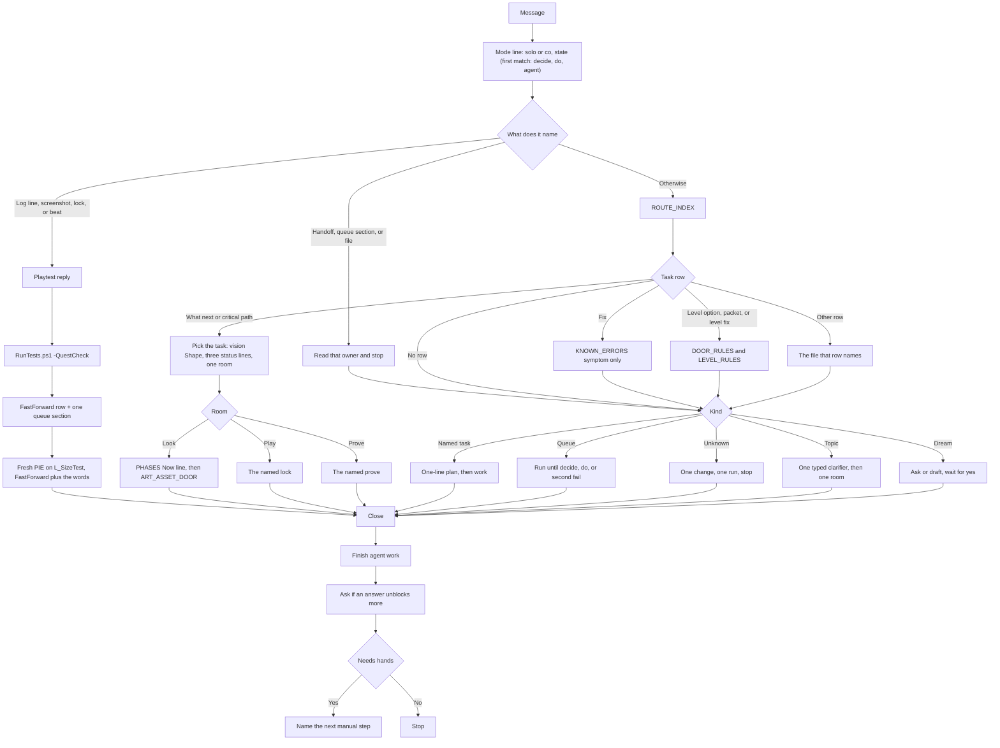

# Session start flow

The door as written in `Docs/context/SESSION_START.md`, redrawn 2026-10-20. This picture is not a second door. When the two differ, the door wins.

Look is art and asset. Play and Prove are the other two rooms. There is no fourth craft room.
